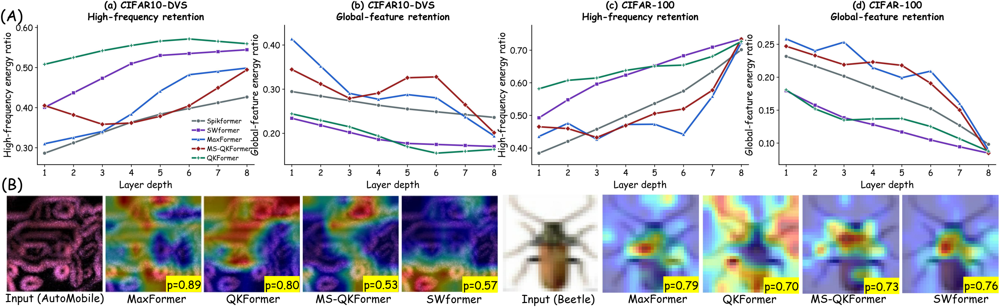
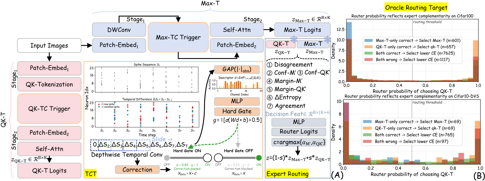

# R-SNN

**Learning When to Correct via Complementarity-Aware Expert Routing for Spiking Vision Transformers**

[中文说明](README.zh-CN.md) · [Training and evaluation](docs/TRAINING.md) · [Data and checkpoints](docs/DATA_AND_CHECKPOINTS.md) · [Acknowledgments](THIRD_PARTY.md)

R-SNN reuses complementary spiking vision experts through a **Temporal-Correction Trigger (TCT)** and **hard Expert Routing (ER)**. Max-Former and QKFormer capture different cues; R-SNN learns when temporal correction is useful and which expert's prediction to select for each sample.



*Teaser from the paper.* [View the original PDF](assets/teaser.pdf).

This source release includes implementations for **CIFAR-10, CIFAR-100, ImageNet-1K, CIFAR10-DVS, and DVS128-Gesture**, together with the paper's teaser and framework figures. Datasets, pretrained weights, training outputs, cached logits, and generated experiment visualizations are not bundled.

## Method



*R-SNN framework: temporal correction and expert routing.* [View the original PDF](assets/mainframe.pdf).

1. **Complementary experts.** Max-Former and QKFormer provide distinct spatial and spectral inductive biases. Their temporal variants are denoted **Max-T** and **QK-T**.
2. **Temporal-Correction Trigger.** Adjacent-step spike differences are processed by a depthwise temporal convolution. A learned hard gate controls a residual correction using temporal evidence and training-time supervision.
3. **Expert Routing.** With both temporal experts frozen, a lightweight MLP uses normalized logit disagreement, two confidence scores, two prediction margins, entropy difference, and prediction agreement: a **K + 6** dimensional feature vector for K classes. A training-only oracle supervises expert selection; inference does not require labels.

**Standard ER executes both experts before selecting one prediction.** Its selection rate is not a reduction in backbone execution cost. A separate budgeted policy conditionally invokes the second expert; the included offline logit experiments simulate this accuracy-computation trade-off. Generic soft fusion is also a competitive baseline, rather than a method that hard ER universally outperforms.

## Reported results

The following **ER2 (Max-T + QK-T)** top-1 accuracies are reported in Table II of the accompanying R-SNN manuscript. They are reference results, not measurements produced by the source-packaging checks.

| Dataset | Timesteps | Top-1 accuracy (%) |
|---|---:|---:|
| CIFAR-10 | 4 | 97.45 |
| CIFAR-100 | 4 | 85.01 |
| ImageNet-1K | 4 | 79.57 |
| CIFAR10-DVS | 16 | 85.20 |
| DVS128-Gesture | 16 | 98.60 |

The manuscript also evaluates **ER1**, which pairs Max-T with MS-QKFormer-Temporal. The corresponding MS-QKFormer configurations are retained for ablations.

## Repository layout

```text
R-SNN/
├── MaxFormer-main/
│   ├── cifar10-100/       # Static-image Max-T and hard router
│   ├── event/             # Event-based TCT, experts, and router
│   └── imagenet_linux_2/  # ImageNet backbones, TCT, and router
│       └── conf/
├── QKFormer-master/
│   ├── cifar10/           # Original QKFormer and temporal adaptation
│   ├── cifar100/
│   ├── cifar10-dvs/
│   ├── dvs128-gesture/
│   └── imagenet/
├── tnnls_experiments/     # Export logits; compare routers and budgets
├── scripts/              # Release checks and exported-logit evaluation
├── assets/               # Paper teaser and framework: PNG previews + original PDFs
├── docs/
├── requirements.txt
└── .gitignore
```

The original sibling-directory structure is retained because model loaders import QKFormer modules by path. Keep these directories together.

## Installation

Use a CUDA-capable environment for the spiking models. Several modules explicitly use SpikingJelly's **CuPy backend**, and the distributed ImageNet scripts use NCCL. Linux is the intended environment for those distributed commands.

Create and activate an isolated Python environment, then install a mutually compatible **PyTorch, torchvision, CUDA, and CuPy** stack. Use the [PyTorch installation guide](https://pytorch.org/get-started/locally/) and [CuPy installation guide](https://docs.cupy.dev/en/stable/install.html) to select the appropriate builds. Preserve the `numpy<2.0` constraint used by this legacy codebase when choosing CuPy.

```bash
python -m venv .venv
source .venv/bin/activate
# Install your compatible PyTorch/torchvision and CuPy builds first.
python -m pip install -r requirements.txt
```

Core source dependencies are `timm==0.6.12` and `spikingjelly==0.0.0.0.12`. Do not replace `clock_driven` with the newer SpikingJelly API without adapting the code. `requirements.txt` is a dependency list, not a validated environment lock. Optional W&B logging additionally requires `wandb`; it is disabled in the supplied configurations. Apex is optional.

Check the GPU environment before training:

```bash
python -c "import torch, cupy, timm; from spikingjelly.clock_driven import neuron; print('CUDA:', torch.cuda.is_available(), 'timm:', timm.__version__); print('CuPy devices:', cupy.cuda.runtime.getDeviceCount())"
```

## Data and pretrained experts

Place data under a local `data/` directory, or edit `data_path` / `data_dir` in the YAML files. Place the required baseline expert weights under `checkpoints/`. Both directories are ignored by Git.

```text
data/
├── cifar10/{train,test}/<class>/...
├── cifar100/{train,test}/<class>/...
├── cifar10-dvs/   # SpikingJelly CIFAR10DVS dataset root
├── dvs128/        # SpikingJelly DVS128Gesture dataset root
└── imagenet/{train,val}/<class>/...
```

CIFAR training uses the ImageFolder-style layout shown above. Keep identical class ordering across expert training and logit export. Event data are integrated into 16-frame samples by the dataset loaders. See [data and checkpoint preparation](docs/DATA_AND_CHECKPOINTS.md) for required filenames and split conventions.

## Quick start: CIFAR-10

Run the following from the repository root after preparing the dataset and original QKFormer checkpoint. Each training stage uses its own configuration; the router stage requires the trained temporal experts.

```bash
# 1. Train the primary temporal expert.
(cd MaxFormer-main/cifar10-100 && python train.py -c cifar10_max_temporal.yaml)

# 2. Adapt the pretrained complementary expert.
(cd QKFormer-master/cifar10 && python train_qk_temporal.py -c cifar10_qk_temporal.yml)

# 3. Freeze both experts and train the hard router.
(cd MaxFormer-main/cifar10-100 && python train.py -c cifar10_max_qk_temporal_router_v2.yaml)
```

The router YAML contains `max_checkpoint`, `qk_checkpoint`, and `qk_model_file`. Check that they point to the weights produced by the preceding stages, especially after changing experiment names. Run training scripts from their own directories so relative paths resolve correctly.

Export and evaluate the trained router:

```bash
python tnnls_experiments/export_static_logits.py \
  --dataset cifar10 --split test \
  --router-checkpoint MaxFormer-main/cifar10-100/output/train/cifar10_max_qk_temporal_router_v2/model_best.pth.tar \
  --output outputs/cifar10_test_logits.npz --device cuda:0

python scripts/evaluate_logits.py --npz outputs/cifar10_test_logits.npz
```

The exporter requires the trained expert checkpoints and the router checkpoint. It fails when the requested router checkpoint is missing, rather than evaluating an uninitialized router.

See [the complete training guide](docs/TRAINING.md) for CIFAR-100, both event datasets, and ImageNet.

## Logit-level baselines and budgeted routing

Export separate training and test logits, then compare oracle selection, average logits, maximum confidence, learned linear/MLP routers, soft gating, and weighted averaging:

```bash
python tnnls_experiments/export_static_logits.py \
  --dataset cifar10 --split train \
  --output outputs/cifar10_train_logits.npz --device cuda:0

python tnnls_experiments/logit_experiments.py \
  --train-npz outputs/cifar10_train_logits.npz \
  --test-npz outputs/cifar10_test_logits.npz \
  --out-dir outputs/cifar10_baselines --device cuda:0
```

For event datasets, use `export_event_logits.py` with `--dataset cifar10dvs` or `--dataset dvsgesture`. The NPZ contract is `y`, `logits_max`, `logits_qk`, and optional `router_logits`. Learned comparisons require training logits; a test-only invocation computes the non-learned comparisons. The learned heads in this script are fitted offline and are distinct from evaluating the saved network router.

Budgeted outputs are offline simulations using cached predictions. The default `--energy-max 1.0 --energy-qk 1.0` represents normalized expert cost, not measured millijoules or end-to-end latency. Test labels are used for evaluation and the oracle upper bound, not as inputs to deployed routing.

## Reproducibility and release scope

```bash
python scripts/check_release.py
```

This validates Python syntax, YAML syntax, external model-file references, and the absence of excluded data, weights, and experiment artifacts. The two paper figures in `assets/` are explicitly allowed. It does not execute model inference or training.

The release preserves the supplied model implementations and experiment schedules, while making paths portable and setting the default ImageNet QK route to the included QKFormer. Use the exact configuration, checkpoint, seed, split, and software environment associated with an experiment when reproducing its reported result. No GPU training or benchmark-accuracy reproduction has been performed as part of packaging this release.

Source, configurations, documentation, and the two supplied paper figures are included. Each figure has a high-resolution PNG for inline display and its unchanged original PDF. Old experiments, unrelated projects, duplicate baseline trees, editor state, virtual environments, generated experiment tables/figures, the full manuscript PDF, and Git history are excluded. Git ignore rules allow the four selected figure files and protect future local experiment artifacts from accidental staging.

## Acknowledgments and citation

This work builds on [Max-Former](https://github.com/bic-L/MaxFormer), [QKFormer](https://github.com/zhouchenlin2096/QKFormer), SpikingJelly, and timm. Upstream attribution headers are retained; see [third-party notes](THIRD_PARTY.md).

Paper title: **R-SNN: Learning When to Correct via Complementarity-Aware Expert Routing for Spiking Vision Transformers**. Public paper links and finalized citation metadata can be added when available; this release does not assign unconfirmed authors, publication status, or a DOI.

